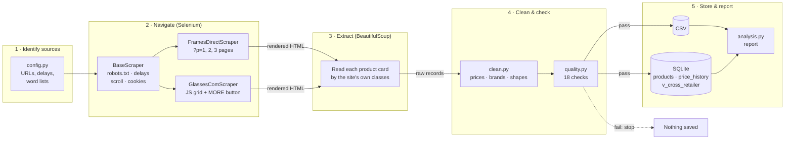

# 👓 Web Scraping for Smarter Eyewear Choices

**Automating prescription-glasses data collection for Frame & Lens**


A web-scraping capstone project. It collects prescription eyeglasses from two online
retailers, **Glasses.com** and **FramesDirect.com**, cleans them into one consistent
dataset, stores them in a CSV file and a database, and produces a report that lets an
optician compare frames, prices and discounts across both sites in one place.

**Tools:** Python, Selenium and BeautifulSoup only, as set out in the project
presentation. Everything else used (`csv`, `sqlite3`, `unittest`, `statistics`) is
built into Python.

---

## Contents

1. [The business problem](#1-the-business-problem)
2. [What the project does](#2-what-the-project-does)
3. [How it works](#3-how-it-works)
4. [Project structure](#4-project-structure)
5. [Quick start](#5-quick-start)
6. [The data collected](#6-the-data-collected)
7. [Results](#7-results)
8. [Key technical decisions](#8-key-technical-decisions)
9. [Responsible scraping](#9-responsible-scraping)
10. [Testing](#10-testing)
11. [Limitations and future work](#11-limitations-and-future-work)

More detail in [`docs/`](docs/): a stage-by-stage walkthrough, the ethics notes, a
presenter's guide and the project slides.

---

## 1. The business problem

**Frame & Lens** is a prescription-glasses and eye-test provider that wants to offer
patients a wider choice of frames by including options from leading online retailers.

Today that is hard because:

| Problem | Effect on the business |
|---|---|
| Product information is scattered across vendors | Patients can't compare options side by side |
| Prices are written differently (`$141` vs `$ 141.00`, list vs sale, "4 colors" vs a row of swatches) | Comparisons are slow and error-prone |
| Availability and prices change daily | Hand-made lists go out of date quickly |
| Data collection is manual | Staff time goes on copy-pasting instead of patient care |

**Goal:** an automated, repeatable process that gathers this data, standardises it and
makes it easy to search.

## 2. What the project does

```
 Glasses.com ─┐                                                        ┌─► eyewear_products.csv
              ├─► Selenium ─► BeautifulSoup ─► Clean & ─► Quality ─► ──┼─► eyewear.db (SQLite)
FramesDirect ─┘   (browse)     (extract)       standardise  checks      └─► summary_report.md
```

* **Navigates** both sites with a real Chrome browser: waits for JavaScript to build the
  product grid, scrolls to load images, presses Glasses.com's **MORE** button and walks
  FramesDirect's numbered pages.
* **Extracts** brand, model, colour, colour code, list price, sale price, discount,
  number of colourways, gender, frame shape, material and the product's **UPC barcode**.
* **Cleans** everything into one format: numeric prices, discount %, price bands,
  standard shape/material/colour names and matching brand names across both sites.
* **Checks quality** with 18 automated checks before anything is saved.
* **Stores** results in CSV (for staff) and SQLite (for searching), keeping a price
  history so price changes can be tracked over time.
* **Finds the same frame on both sites** by brand and model number, and shows where it
  is cheaper.
* **Reports** with summary tables and text charts that display directly on GitHub.

## 3. How it works



These five stages are the **Project Workflow** slide in the presentation.
[`docs/WALKTHROUGH.md`](docs/WALKTHROUGH.md) explains each one with code references.

## 4. Project structure

```
smart-eyewear-scraper/
├── main.py                  # Runs the whole workflow from the command line
├── config.py                # Website addresses, politeness settings, standard word lists
├── scrapers/
│   ├── base.py              # Selenium: browser setup, robots.txt, delays, scrolling, saving pages
│   ├── framesdirect.py      # FramesDirect.com scraper (numbered pages)
│   ├── glasses_com.py       # Glasses.com scraper (JavaScript grid + MORE button)
│   └── card_parsing.py      # Shared BeautifulSoup helpers and a layout-independent fallback
├── pipeline/
│   ├── clean.py             # Cleaning and standardisation
│   ├── quality.py           # Data-quality checks
│   ├── storage.py           # CSV + SQLite (upserts, price history, cross-retailer view)
│   └── analysis.py          # Markdown report with tables and text charts
├── tests/
│   ├── real_listings.py     # Real listings captured from both sites on 30 Oct 2026
│   ├── make_fixtures.py     # Rebuilds saved pages using each site's real HTML structure
│   └── test_pipeline.py     # 22 tests (Python's built-in unittest)
├── sample_data/             # Demo pages, built automatically from tests/real_listings.py
├── reports/                 # The generated report
├── data/                    # Live-run output (not uploaded): raw pages, CSV, database
├── docs/                    # Walkthrough, ethics, presenter's guide, slides
└── requirements.txt         # selenium, beautifulsoup4
```

## 5. Quick start

### You need
* Python 3.10 or newer
* Google Chrome (Selenium downloads the matching ChromeDriver automatically)

### Install
```bash
git clone https://github.com/<GLICON>/smart-eyewear-scraper.git
cd smart-eyewear-scraper
python -m venv .venv
source .venv/bin/activate          # Windows: .venv\Scripts\activate
pip install -r requirements.txt
```

### Run
```bash
# A. Offline demo: no internet or Chrome needed. Builds the saved pages and runs the pipeline.
python main.py --from-html sample_data

# B. Live scrape: both retailers, 3 pages / MORE-presses each (about 70 frames per site)
python main.py --max-pages 3

# C. Watch the browser work (good for a live demo)
python main.py --sites framesdirect --max-pages 1 --show-browser

# D. Run the tests
python -m unittest discover -s tests -v
```

Every live run saves the pages it visited to `data/raw/`, so they can be re-processed
later with `--from-html data/raw` without visiting the sites again.

### Search the database
```bash
sqlite3 data/processed/eyewear.db
```
```sql
-- Women's frames under $150, cheapest first
SELECT retailer, brand, model, color, final_price
FROM products
WHERE gender IN ('Women','Unisex') AND final_price < 150
ORDER BY final_price;

-- The same frame model on both sites
SELECT brand, model_code, framesdirect_price, glasses_com_price, cheaper_at
FROM v_cross_retailer;
```

## 6. The data collected

| Column | Example | Notes |
|---|---|---|
| `retailer` | FramesDirect | Source site |
| `brand` / `model` | Ray-Ban / RB7047 | Brand names matched across sites (`Polo` = `Polo Ralph Lauren`) |
| `model_code` | RB7047 | Manufacturer model number, used to match frames across sites |
| `color` / `color_code` | Matte Black / 5196 | FramesDirect only; Glasses.com tiles don't show colour |
| `color_family` | Black | Grouped for filtering (Tortoise, Grey/Silver, Clear …) |
| `list_price` / `sale_price` | 141.00 / 105.75 | USD |
| `final_price` | 105.75 | What the patient pays (sale price if there is one) |
| `discount_pct` / `on_sale` | 25.0 / True | Worked out from the two prices |
| `price_band` | $100-$149 | Under $100 · $100-149 · $150-249 · $250-399 · $400+ |
| `includes_lenses` | True | Glasses.com marks some offers "including lenses" |
| `gender` | Unisex | Men / Women / Unisex / Kids |
| `shape` | Rectangle | Standard shape name (Rectangular → Rectangle) |
| `material` | Metal | Standard material name |
| `num_colors` | 6 | Number of colourways |
| `upc` | 7895653344952 | 13-digit barcode |
| `product_url` | https://… | Link to the product |
| `scraped_at` | 2026-10-30T21:23:28+00:00 | When it was collected (UTC) |

## 7. Results

The offline demo uses **real listings captured from both sites on 30 October 2026**:
FramesDirect pages 1–2 (48 frames) and the first 52 frames on Glasses.com.
Full report: [`reports/summary_report.md`](reports/summary_report.md)

| Retailer | Frames | Brands | Median price | Range | On sale | Avg discount (on sale) |
|---|---:|---:|---:|---:|---:|---:|
| FramesDirect | 48 | 16 | $210.00 | $93.50 – $387.00 | 40% | 28% |
| Glasses.com | 52 | 22 | $149.70 | $70.50 – $442.00 | 92% | 30% |

**What the data shows**

* **Glasses.com leans cheaper and more discounted.** Half its frames cost under $150
  after discount, against 15% on FramesDirect, and 92% of its listed frames were on sale.
* **FramesDirect publishes richer detail.** Every frame came with colour, gender and a
  UPC, and most with shape; Glasses.com's listing tiles show no colour, shape or material.
* **Four frame models appear on both sites, all at identical prices** (Armani Exchange
  AX1017, Oakley OX8060, Ralph RA7158U, Ray-Ban RB5154). Both retailers belong to the
  same parent company (EssilorLuxottica), which likely explains the matching prices.
  For Frame & Lens the value is in the combined **range** rather than price gaps.

**What this gives Frame & Lens:** one catalogue across both retailers that staff can
filter by budget, brand, shape, gender or colour; a database that tracks price changes
run by run; and a repeatable process instead of manual copying.

## 8. Key technical decisions

| Decision | Why |
|---|---|
| **Selenium + BeautifulSoup** | Glasses.com builds its product grid with JavaScript, so a plain download of the page has no products. Selenium runs a real browser to render the page and press buttons; BeautifulSoup then reads the finished HTML quickly and clearly. |
| **Read each site's own CSS classes, with a fallback** | The parsers use the real class names found on the live sites (`.prod-holder`, `.product-tile` …). If a redesign removes them, a fallback finds products from their link pattern and reads the card's text, and the quality report flags missing fields. |
| **Use FramesDirect's hidden product data** | Each card carries hidden fields with gender, shape, material, UPC and clean prices. Reading those is more reliable than reading display text. |
| **Match frames by brand + model number** | Names differ ("RB5154 Clubmaster" vs "RB5154 Clubmaster Optics") and each colour has its own UPC, but the manufacturer's model number is the same on both sites. |
| **Quality checks before saving** | Bad data never reaches the database; a broken scrape stops with a clear message. |
| **Save every page visited** | Makes runs reproducible and lets the parsing be improved without visiting the sites again. |
| **Python's built-in tools only** | Keeps the project to the presentation's toolset: `csv` and `sqlite3` for storage, `unittest` for tests. |

## 9. Responsible scraping

* Checks each site's **robots.txt** before each page and skips anything disallowed.
* Waits a **random 3–6 seconds** between pages and keeps page limits small by default.
* Collects **public product information only**: no logins, accounts, personal data or
  checkout pages.
* Picks the **most privacy-friendly option** on cookie banners.
* Identifies itself honestly in its browser user agent.
* For research and internal comparison. **Read each site's Terms of Use before a live
  scrape**, and use an official product feed or partnership for production.

Details: [`docs/ETHICS.md`](docs/ETHICS.md)

## 10. Testing

```bash
python -m unittest discover -s tests -v
```

22 tests check: parsing every product on both sites (including skipping FramesDirect's
promotional slot and Glasses.com's menu links), sale and full-price frames, the fallback
parser, price parsing, gender/shape/material/colour standardisation, brand matching
across sites, model numbers, barcodes, the quality checks (including stopping an empty
scrape), CSV output, the database (updates, run history and the cross-retailer view)
and the Selenium page loop with a simulated browser.

The saved test pages are rebuilt from real listings using each site's real HTML
structure, captured on 30 October 2026.

## 11. Limitations and future work

* **Websites change.** The fallback parser and saved pages make fixes quick, but the
  scrapers will need occasional maintenance.
* **Listing pages only.** Frame measurements (lens width, bridge, temple) and Glasses.com
  colours/shapes are on product pages; visiting each product is the natural next step.
* **Lens prices vary by prescription**, so the comparison is of frames (Glasses.com notes
  when an offer includes basic lenses).
* **Next steps:** weekly scheduled runs, product-page details, more retailers (add one by
  writing a new class based on `BaseScraper`), and a simple search page for staff.

---

*Capstone project, Web Scraping specialisation. Tools: Python, Selenium, BeautifulSoup.*
